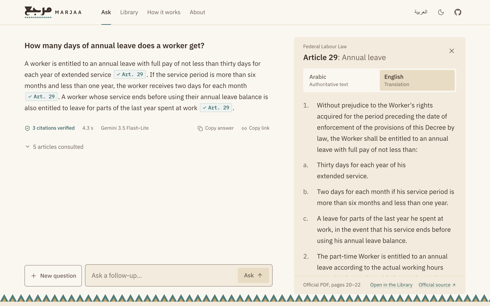
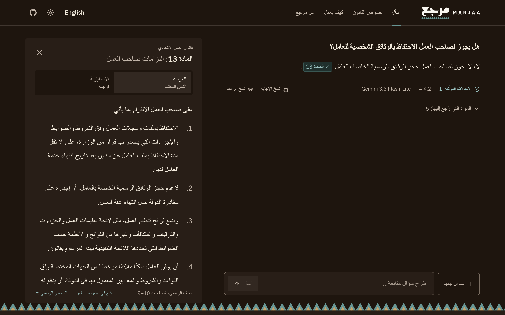
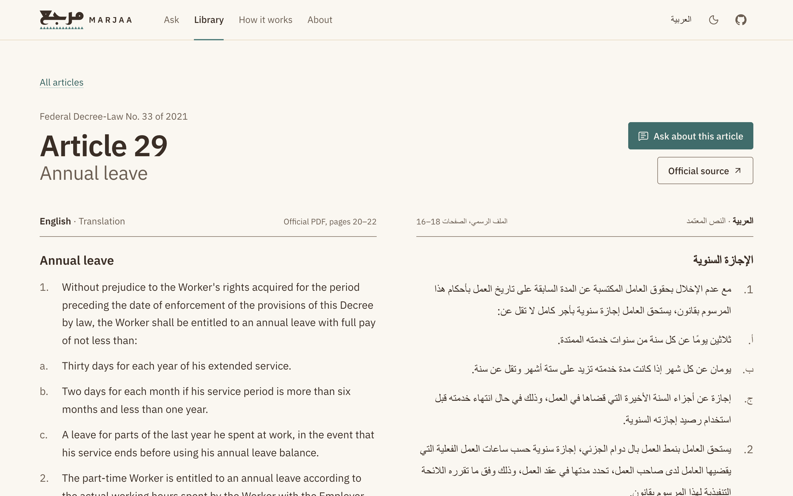
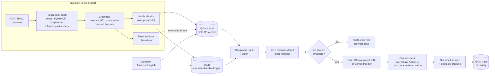

# Marjaa (مرجع)

**Bilingual Arabic/English question answering over UAE law, with exact article citations.**

Ask a question about the UAE Federal Labour Law in Arabic or English. Marjaa finds the relevant
articles, answers in your language, and cites every claim as `[Federal Labour Law, Article 29]`
or `[قانون العمل الاتحادي، المادة 29]`. Citations are checked in code against the retrieved
articles, and when the law does not cover the question it says so instead of guessing.

> **Not legal advice.** This is a portfolio project. The Arabic text of UAE legislation is the
> legally authoritative version; the English text is a translation.

[](https://github.com/faresabusaleem/marjaa/actions/workflows/ci.yml)

**Live demo: [marjaa-uae.vercel.app](https://marjaa-uae.vercel.app)** ·
[in Arabic](https://marjaa-uae.vercel.app/ar) ·
[How it works, with measured results](https://marjaa-uae.vercel.app/how-it-works) ·
[Read the law](https://marjaa-uae.vercel.app/library)



Every chip is a citation the backend checked against the retrieved articles; clicking one opens
the article in Arabic (the authoritative text) and English. The demo runs a lighter, hosted
version of the pipeline (Gemini embeddings and answers, no reranker), measured with the same
test set as the full local one: see [The hosted pipeline](#the-hosted-pipeline-live-demo).

<details>
<summary>Arabic interface, dark mode</summary>



</details>

<details>
<summary>The Library: every article in Arabic and English</summary>



</details>

The interface is fully bilingual (English at `/`, Arabic at `/ar`, right to left) and follows
a small brand system, documented in [docs/brand.md](docs/brand.md): the Sadu-band logo, a
palette of Pearl, Sand, Dune, Sea and Date with every text colour checked against WCAG AA in
both themes, and IBM Plex Sans with Plex Sans Arabic.

<!-- examples:start -->
**Real outputs** (local `qwen3.5:4b`, copied from `data/traces/`):

> **Q:** ما هي مدة الإجازة السنوية التي يستحقها العامل؟  
> **A:**
>
> <div dir="rtl">
>
> يستحق العامل إجازة سنوية بأجر كامل لا تقل عن ثلاثين يومًا عن كل سنة من سنوات خدمته الممتدة، أو يومين عن كل شهر إذا كانت مدة خدمته تزيد على ستة أشهر وتقل عن سنة. [قانون العمل الاتحادي، المادة 29]
>
> ويستحق العامل بنمط العمل بدوام جزئي إجازة سنوية حسب ساعات العمل الفعلية التي يقضيها لدى صاحب العمل، تحدد مدتها في عقد العمل. [قانون العمل الاتحادي، المادة 29]
>
> ولا يجوز لصاحب العمل منع العامل من الاستفادة من إجازته السنوية المستحقة لأكثر من سنتين، إلا إذا رغب العامل بترحيلها أو الحصول على بدل نقدي عنها. [قانون العمل الاتحادي، المادة 29]
>
> </div>

> **Q:** What is the maximum probation period?  
> **A:** The Employer may appoint a Worker under the Probation Period for a period not exceeding six (6) months as of the date of commencing work [Federal Labour Law, Article 9]. A Worker may not be appointed under probation more than once with one employer [Federal Labour Law, Article 9]. The Ministry may exempt some job categories from the condition of not granting a work permit stipulated in Clauses (4) and (6) of this Article [Federal Labour Law, Article 9].

> **Q:** What is the fine for running a red light in Dubai?  
> **A:** Not found in the provided laws.
<!-- examples:end -->

## Contents

- [How it works](#how-it-works)
- [Results](#results)
- [Run it locally](#run-it-locally)
- [Design decisions and trade-offs](#design-decisions-and-trade-offs)
- [Evaluation method](#evaluation-method)
- [API](#api)
- [Deployment](#deployment)
- [Limitations](#limitations)
- [Project layout](#project-layout)

## How it works



1. **Ingestion.** Every installed PDF parser is tried on Arabic files and the cleanest output
   wins (see [Arabic PDF extraction](#arabic-pdf-extraction)). Text is split into one chunk per
   legal article (long articles are split on paragraph boundaries, repeating the heading and
   title), plus fixed-size windows as a baseline. Each chunk keeps the law name, number, year,
   language, article number, title, source file and pages.
2. **Retrieval.** Dense search (BGE-M3 in Qdrant local mode) and BM25 over normalised text run
   in parallel, are merged with Reciprocal Rank Fusion, and the top 20 are re-scored by the BGE
   cross-encoder reranker. Arabic and English versions sit in one index, and BGE-M3 maps both
   languages into the same space, so an Arabic question can find an English article.
3. **Generation.** The top 5 distinct articles go into the prompt, each with the exact citation
   label to copy. The answer streams token by token. Afterwards every citation is parsed and
   checked against the retrieved articles; unverified ones are flagged in the UI.
4. **Abstention.** If the reranker's best score is below a threshold tuned on the dev split,
   Marjaa answers "not found in the provided laws" without calling the LLM.

## Results

Every table below is written by `make eval` and copied in by `scripts/update_readme.py`;
the numbers quoted in the text are taken from those tables. Test set: **auto-generated** from
the law text, 126 questions (see [Evaluation method](#evaluation-method)). Latency is measured
on a MacBook Pro M1 Pro (32 GB), with the embedder, reranker and LLM sharing one GPU.

### Retrieval: 4 retrievers × 2 chunking strategies

<!-- results:retrieval:start -->
<!-- generated by evals/runners/run_retrieval.py on 2026-11-07 -->
Questions: 103 answerable (all splits). Embedder `BAAI/bge-m3`, reranker `BAAI/bge-reranker-v2-m3` (20 candidates, 1024 tokens, fp32). Latency measured on arm64 Darwin.

| Chunking | Retrieval | Recall@1 | Recall@5 | Recall@10 | MRR | nDCG@10 | p50 latency |
|---|---|---|---|---|---|---|---|
| article | Dense (BGE-M3) | 0.835 | 0.937 | 0.966 | 0.931 | 0.922 | 34 ms |
| article | BM25 | 0.665 | 0.738 | 0.752 | 0.740 | 0.727 | 0 ms |
| article | Hybrid (RRF) | 0.854 | 0.956 | 0.971 | 0.943 | 0.937 | 34 ms |
| article | Hybrid + rerank | 0.942 | 0.981 | 0.981 | 1.000 | 0.982 | 2685 ms |
| fixed | Dense (BGE-M3) | 0.825 | 0.951 | 0.971 | 0.894 | 0.910 | 25 ms |
| fixed | BM25 | 0.680 | 0.762 | 0.762 | 0.727 | 0.735 | 0 ms |
| fixed | Hybrid (RRF) | 0.874 | 0.966 | 0.966 | 0.925 | 0.934 | 25 ms |
| fixed | Hybrid + rerank | 0.971 | 0.990 | 0.990 | 0.985 | 0.986 | 2085 ms |

Recall@5 by question type:

| Chunking | Retrieval | Arabic | AR question → EN text | EN question → AR text | English | Multi-article |
|---|---|---|---|---|---|---|
| article | Dense (BGE-M3) | 1.000 | 1.000 | 0.917 | 0.941 | 0.708 |
| article | BM25 | 1.000 | 0.083 | 0.000 | 1.000 | 0.667 |
| article | Hybrid (RRF) | 1.000 | 1.000 | 0.917 | 0.971 | 0.792 |
| article | Hybrid + rerank | 1.000 | 1.000 | 1.000 | 1.000 | 0.833 |
| fixed | Dense (BGE-M3) | 0.970 | 0.917 | 0.917 | 0.941 | 1.000 |
| fixed | BM25 | 1.000 | 0.083 | 0.000 | 1.000 | 0.875 |
| fixed | Hybrid (RRF) | 0.970 | 0.917 | 0.917 | 1.000 | 0.958 |
| fixed | Hybrid + rerank | 1.000 | 0.917 | 1.000 | 1.000 | 1.000 |

n per type: Arabic = 33, AR question → EN text = 12, EN question → AR text = 12, English = 34, Multi-article = 12

Single-article vs multi-article questions:

| Chunking | Retrieval | Single-article Recall@1 | Multi-article Recall@10 |
|---|---|---|---|
| article | Dense (BGE-M3) | 0.879 | 0.792 |
| article | BM25 | 0.692 | 0.792 |
| article | Hybrid (RRF) | 0.912 | 0.833 |
| article | Hybrid + rerank | 1.000 | 0.833 |
| fixed | Dense (BGE-M3) | 0.835 | 1.000 |
| fixed | BM25 | 0.681 | 0.875 |
| fixed | Hybrid (RRF) | 0.890 | 0.958 |
| fixed | Hybrid + rerank | 0.978 | 1.000 |
<!-- results:retrieval:end -->

**Faster reranking** (10 candidates, 512 tokens, fp16), the latency/quality trade-off:

<!-- results:retrieval_fast_rerank:start -->
<!-- generated by evals/runners/run_retrieval.py on 2026-11-07 -->
Questions: 103 answerable (all splits). Embedder `BAAI/bge-m3`, reranker `BAAI/bge-reranker-v2-m3` (10 candidates, 512 tokens, fp16). Latency measured on arm64 Darwin.

| Chunking | Retrieval | Recall@1 | Recall@5 | Recall@10 | MRR | nDCG@10 | p50 latency |
|---|---|---|---|---|---|---|---|
| article | Hybrid + rerank | 0.932 | 0.971 | 0.971 | 0.990 | 0.972 | 1198 ms |
| fixed | Hybrid + rerank | 0.942 | 0.966 | 0.966 | 0.957 | 0.956 | 1089 ms |

Recall@5 by question type:

| Chunking | Retrieval | Arabic | AR question → EN text | EN question → AR text | English | Multi-article |
|---|---|---|---|---|---|---|
| article | Hybrid + rerank | 1.000 | 1.000 | 1.000 | 0.971 | 0.833 |
| fixed | Hybrid + rerank | 0.970 | 0.917 | 0.917 | 1.000 | 0.958 |

n per type: Arabic = 33, AR question → EN text = 12, EN question → AR text = 12, English = 34, Multi-article = 12

Single-article vs multi-article questions:

| Chunking | Retrieval | Single-article Recall@1 | Multi-article Recall@10 |
|---|---|---|---|
| article | Hybrid + rerank | 0.989 | 0.833 |
| fixed | Hybrid + rerank | 0.945 | 0.958 |
<!-- results:retrieval_fast_rerank:end -->

### Answers (hybrid + rerank, article chunks, test split)

<!-- results:answers:start -->
<!-- generated by evals/runners/run_answers.py on 2026-11-09 -->
Split `test`: 71 answerable + 16 unanswerable questions. Generator `ollama:qwen3.5:4b`, judge `ollama:qwen3.5:9b`, retrieval `article chunks, hybrid_rerank`, not-found threshold 0.0919.

| Metric | Value |
|---|---|
| Correctness (judge, answered questions) | 91.5% |
| Faithfulness to sources (judge) | 90.1% |
| Correct over all answerable (abstain = wrong) | 91.5% |
| Citation validity (cites a retrieved article, code-checked) | 100.0% |
| Answers with at least one citation | 95.8% |
| Gold article cited | 89.4% |
| Sentences carrying a citation | 86.0% |
| Answers containing text from the prompt's format example | 0 |
| Unanswerable → correctly said 'not found' | 100.0% |
| Answerable → wrongly said 'not found' | 0.0% |
| Latency p50 / p95, retrieval | 4774 / 5634 ms |
| Latency p50 / p95, first token | 13527 / 17635 ms |
| Latency p50 / p95, full answer | 16713 / 22536 ms |
<!-- results:answers:end -->

**Prompt ablation.** The first run used rules only ("cite after every sentence") and the 4B
model skipped citations in about one answer in five. A two-sentence format example fixed that.
The first example was about "10 days of study leave"; it never leaked into the 87 test answers,
but in manual testing the model copied it word for word into the answer to the short question
"كم مدة فترة التجربة؟", with a citation that passed the check because the cited article *was*
retrieved. The final example is about park opening hours, which cannot pass for labour law, and
the answer eval now counts leaks. Same test split, same retrieval in all three runs:

<!-- results:prompt_comparison:start -->
| Metric | Rules only | + example (study leave) | + example (parks, final) |
|---|---|---|---|
| Correctness (judge) | 90.1% | 85.9% | 91.5% |
| Faithfulness (judge) | 93.0% | 87.3% | 90.1% |
| Citation validity | 100.0% | 100.0% | 100.0% |
| Answers with at least one citation | 78.9% | 97.2% | 95.8% |
| Gold article cited | 75.3% | 89.4% | 89.4% |
| Sentences carrying a citation | 59.1% | 87.3% | 86.0% |
<!-- results:prompt_comparison:end -->

**How much does the judge matter?** The earlier runs were first graded by the 4B generator
itself. `make eval-rejudge` re-grades their stored answers with the 9B judge (showing it exactly
the articles the generator saw), which also measures how often the two judges agree:

<!-- results:judge_agreement:start -->
The same 142 answers graded by `ollama:qwen3.5:4b` and `ollama:qwen3.5:9b`:

| Label | Agreement | Cohen's kappa | Rate, old judge | Rate, new judge |
|---|---|---|---|---|
| correctness | 88.0% | 0.35 | 91.5% | 88.0% |
| faithfulness | 92.3% | 0.62 | 86.6% | 90.1% |
<!-- results:judge_agreement:end -->

### The hosted pipeline (live demo)

The demo runs on Vercel's free tier, which cannot host BGE-M3, the reranker or Ollama (see
[Deployment](#deployment)). It uses Gemini embeddings (`gemini-embedding-2`, 768 dimensions,
precomputed for the 159 article chunks) with BM25 + RRF and **no reranker**, and
`gemini-3.5-flash-lite` for answers; without a reranker the "not found" signal is the best
dense cosine similarity, calibrated on the dev split the same way. Same test questions, same
9B judge. `make hosted-index && make eval-hosted` reproduces it (needs `GEMINI_API_KEY`).

<!-- results:retrieval_hosted:start -->
<!-- generated by evals/runners/run_retrieval.py on 2026-11-09 -->
Questions: 103 answerable (all splits). Embedder `gemini-embedding-2`. Latency measured on arm64 Darwin (includes the Gemini API call).

| Chunking | Retrieval | Recall@1 | Recall@5 | Recall@10 | MRR | nDCG@10 | p50 latency |
|---|---|---|---|---|---|---|---|
| article | Dense (gemini-embedding-2) | 0.922 | 0.971 | 0.981 | 0.989 | 0.967 | 494 ms |
| article | BM25 | 0.665 | 0.738 | 0.752 | 0.740 | 0.727 | 0 ms |
| article | Hybrid (RRF) | 0.932 | 0.976 | 0.981 | 0.990 | 0.976 | 503 ms |

Recall@5 by question type:

| Chunking | Retrieval | Arabic | AR question → EN text | EN question → AR text | English | Multi-article |
|---|---|---|---|---|---|---|
| article | Dense (gemini-embedding-2) | 1.000 | 1.000 | 1.000 | 1.000 | 0.750 |
| article | BM25 | 1.000 | 0.083 | 0.000 | 1.000 | 0.667 |
| article | Hybrid (RRF) | 1.000 | 1.000 | 1.000 | 1.000 | 0.792 |

n per type: Arabic = 33, AR question → EN text = 12, EN question → AR text = 12, English = 34, Multi-article = 12

Single-article vs multi-article questions:

| Chunking | Retrieval | Single-article Recall@1 | Multi-article Recall@10 |
|---|---|---|---|
| article | Dense (gemini-embedding-2) | 0.978 | 0.833 |
| article | BM25 | 0.692 | 0.792 |
| article | Hybrid (RRF) | 1.000 | 0.833 |
<!-- results:retrieval_hosted:end -->

<!-- results:answers_hosted:start -->
<!-- generated by evals/runners/run_answers.py on 2026-11-09 -->
Split `test`: 71 answerable + 16 unanswerable questions. Generator `gemini:gemini-3.5-flash-lite`, judge `ollama:qwen3.5:9b`, retrieval `article chunks, hybrid`, not-found threshold 0.7038.

| Metric | Value |
|---|---|
| Correctness (judge, answered questions) | 89.7% |
| Faithfulness to sources (judge) | 94.1% |
| Correct over all answerable (abstain = wrong) | 85.9% |
| Citation validity (cites a retrieved article, code-checked) | 99.4% |
| Answers with at least one citation | 100.0% |
| Gold article cited | 96.3% |
| Sentences carrying a citation | 97.5% |
| Answers containing text from the prompt's format example | 0 |
| Unanswerable → correctly said 'not found' | 100.0% |
| Answerable → wrongly said 'not found' | 4.2% |
| Latency p50 / p95, retrieval | 649 / 1306 ms |
| Latency p50 / p95, first token | 3652 / 4798 ms |
| Latency p50 / p95, full answer | 4985 / 6479 ms |
<!-- results:answers_hosted:end -->

### "Not found" threshold

<!-- results:threshold:start -->
Calibrated on the dev split (32 answerable, 7 unanswerable questions): threshold **0.0919** on the reranker's top score, balanced accuracy 1.000.
<!-- results:threshold:end -->

<!-- findings:start -->
### What the numbers say

- **Each stage earns its place.** On article chunks, Recall@5 goes 0.738 (BM25) → 0.937
  (dense) → 0.956 (hybrid) → 0.981 (hybrid + rerank), and MRR from 0.740 to 1.000. The
  reranker's main contribution is putting the right article *first*: Recall@1 on single-article
  questions rises from 0.912 (hybrid) to 1.000, i.e. 91 out of 91.
- **BM25 cannot cross languages; fusion fixes that.** BM25 finds an English article for an
  Arabic question 8% of the time and an Arabic article for an English question 0% of the time.
  Dense retrieval gets 1.000 and 0.917, and the hybrid keeps those hits because RRF only needs
  one list to rank a document highly. On same-language questions BM25 is perfect at Recall@5,
  which is why it is worth keeping.
- **Article chunks vs fixed windows is a real trade-off, not a clear win.** Fixed windows score
  higher overall (Recall@5 0.990 vs 0.981 with rerank), but only because of the multi-article
  questions: they were built from *adjacent* articles, which a 1,200-character window often
  covers in one chunk. On single-article questions article chunks are better (Recall@1 1.000 vs
  0.978), and only they give one article per chunk, which is what an exact citation needs.
  Marjaa uses article chunks.
- **Reranking is the expensive step.** It takes most of the retrieval time on a laptop GPU. A
  lighter setting (10 candidates, 512 tokens, fp16) roughly halves it at a small cost: Recall@5
  0.971 instead of 0.981, single-article Recall@1 0.989 instead of 1.000.
- **Read these as an upper bound.** The questions were written by an LLM looking at the article,
  so they reuse its wording; real users phrase things less helpfully.
- **Citations are always real; the format example made them consistent.** Every citation in
  all three runs pointed to an article the model was actually given (100% validity, checked in
  code). With rules only, the 4B model left 21% of answers uncited. With a two-sentence format
  example, 97.2% and 95.8% of answers carried a citation (study-leave and parks example),
  sentences with a citation rose from 59.1% to 87.3% and 86.0%, and answers citing the gold
  article from 75.3% to 89.4% in both.
- **The prompt changes did not measurably change correctness, and the judge is why we can't
  say more.** With all three runs graded by the 9B judge, correctness is 90.1% (rules only),
  85.9% (study-leave example) and 91.5% (parks example). Between the first and last run, 5 of
  71 questions changed grade (3 up, 2 down). The judges disagree with each other more than
  that: on the same 142 answers, the 4B and 9B judges gave a different correctness grade 12%
  of the time (Cohen's kappa 0.35). So the format example is credited only with the citation
  gains, which are checked in code; ranking prompts on correctness would need human-checked
  labels.
- **"Not found" is clean on this set.** All 16 out-of-scope test questions were stopped by the
  threshold before reaching the LLM, and none of the 71 answerable ones were. The gap is wide:
  the best-scoring out-of-scope question reached 0.018 on the reranker, the worst answerable one
  0.762, so the dev-split threshold (0.0919) did not need to be precise.
- **The hosted version gives up little on retrieval.** Without the reranker and with Gemini
  embeddings, hybrid Recall@5 is 0.976 against 0.981 for the full pipeline, MRR 0.990 against
  1.000, and single-article Recall@1 is still 1.000. Gemini's embeddings alone (Recall@5 0.971)
  beat BGE-M3's (0.937), and cross-language retrieval is perfect in both directions.
- **Its answers are better cited, but its "not found" gate is thinner.** Gemini cited something
  in every answer (100% against 95.8%) and in 97.5% of sentences (86.0% locally), and cited the
  gold article in 96.3% of answers (89.4%); judged correctness is similar (89.7% against 91.5%,
  within the judge's noise). The one invalid citation was a typo, `[Federal LabourLaw, ...]`,
  which the checker refused. The costs: dense cosine separates in-scope from out-of-scope
  questions far less cleanly than the reranker did. On the test split the best out-of-scope
  question scored 0.705 and the worst in-scope one 0.723, around a cut-off of 0.704 calibrated
  on dev, so one out-of-scope question passed the gate and Gemini itself declined it. Gemini
  also answered "not found" to 3 of 71 in-scope questions (4.2%); in one of them the right
  article had not been retrieved.
- **Latency is the cost of running everything on a laptop.** Locally a full answer takes about
  17 s at the median: about 5 s of retrieval (mostly reranking) and about 9 s more for the 4B
  model to read five articles before the first token. Laptop timings vary between runs; the
  previous committed run of the same pipeline measured 15.2 s. The hosted pipeline answers in
  5.0 s at the median, measured from the same laptop to the Gemini API.
<!-- findings:end -->

## Run it locally

Needs macOS or Linux, [uv](https://docs.astral.sh/uv/) and [Ollama](https://ollama.com).
About 9 GB of disk for models (BGE-M3 + reranker ≈ 4.5 GB, qwen3.5:4b ≈ 4 GB).

**Get the data.** Download the two official PDFs of Federal Decree-Law No. 33 of 2021 from
[uaelegislation.gov.ae](https://uaelegislation.gov.ae/en/legislations/1541) (English and
Arabic) and save them as `data/raw/uae_labour_law_2021_en.pdf` and
`data/raw/uae_labour_law_2021_ar.pdf`. They are not committed to this repository.

```bash
make install                 # uv sync: Python 3.12 + all dependencies
```
```bash
ollama pull qwen3.5:4b       # with `ollama serve` running
```
```bash
make ingest                  # parse, chunk, embed, index (~1.5 min on an M1 Pro)
```
```bash
make serve                   # API on http://127.0.0.1:8000, UI on /ui
```

Other commands: `make eval` (reproduce every result), `make test`, `make lint`,
`make eval-smoke` (offline end-to-end check), `uv run marjaa ask "..." --show-sources`.

**The web app** (Node 20.9+): with `make serve` running, `cd web && npm ci && cd ..` once,
then `make web` serves it on http://localhost:3000 against the local pipeline. To run the
hosted pipeline instead, put a free Gemini key in `.env` and use `make serve-hosted`. It has
four pages, each in English and Arabic: Ask, the Library (all 74 articles, side by side, with
search), How it works (the measured results, read from `web/src/data/results.json`) and About.
`make web-test` runs its unit tests (design-token contrast, law text layout, search, citation
parsing); `make brand` redraws the logo files and `make web-data` re-exports the Library's
text from the hosted chunks.

To use the free Gemini API instead of Ollama, copy `.env.example` to `.env`, add a key from
[Google AI Studio](https://aistudio.google.com/apikey) and set `MARJAA_LLM_PROVIDER=gemini`.

### Adding another law

Drop its Arabic and English PDF (or HTML) into `data/raw/`, add a `[[law]]` entry to
`data/raw/laws.toml` (name, number, year, file names) and run `make ingest`. Files without an
entry are still ingested if named `<law_id>_<ar|en>.pdf`.

## Design decisions and trade-offs

### Arabic PDF extraction

Arabic PDF extraction is easy to get silently wrong. I scored each parser's output on
the official Arabic PDF with `text_quality()` (share of common words read forwards vs.
backwards, presentation-form glyphs, swapped lam-alef pairs, average word length):

| Parser | What went wrong | Quality score |
|---|---|---|
| pdfplumber | Text in *visual* order: every word reversed (`ةداملا`) | <!-- q:pdfplumber --> -0.1927 |
| PyMuPDF | Lam-alef decomposed in the wrong order: `عالقات` for `علاقات`, `املتحدة` for `المتحدة` | <!-- q:pymupdf --> -0.2562 |
| **pypdf** | Clean; a few words split by a space | <!-- q:pypdf --> 0.2179 |

`parser="auto"` runs all installed parsers and keeps the best, and ingestion refuses to index
Arabic that scores as unreadable rather than silently embedding garbage. Scores are written to
`data/processed/ingest_report.json` on every ingest.

### Choices

| Decision | Why | Trade-off |
|---|---|---|
| **One chunk per article** (sub-split > 2,500 chars, heading + title repeated) | Articles are the unit lawyers cite, so a chunk maps 1:1 to a citation. | Very long articles (definitions) need sub-splitting; cross-article context is lost. |
| **Arabic + English in one index** | One query searches both; the UI can show the authoritative Arabic next to the English. | Both copies of an article can take two of the top-5 slots, so the context builder keeps one copy per article (preferring the question's language). |
| **BGE-M3** for embeddings | Strong multilingual model (100+ languages, Arabic included) with one shared space for Arabic and English, which is what makes cross-lingual retrieval work. 568M params runs on a laptop. | 2.2 GB of weights; slower than small English-only models. |
| **BM25 alongside dense** | Catches exact legal terms and numbers that embeddings blur. | Cannot match across languages, so it hurts cross-lingual questions unless fused. |
| **RRF** for fusion | Uses ranks only, so unbounded BM25 scores and cosine similarities combine without calibration. Standard k = 60. | Ignores score magnitude. |
| **Cross-encoder reranker** (BGE reranker v2-m3) | Reads question and article together; its sigmoid score doubles as a confidence signal for "not found". | Adds latency per query (see the latency column). |
| **Threshold tuned on a dev split** | The "not found" cut-off is chosen on dev questions only and then frozen, so test numbers are not tuned on test data. | Small dev set: the threshold is coarse. |
| **Light stemming + normalisation** for BM25 | Removing diacritics/tatweel, unifying أ/إ/آ, ة/ه, ى/ي and digits, and stripping common clitics (ال، وال، بال…) fixes most Arabic spelling variation without a heavy morphological analyser. | Over- and under-stemming on some words. |
| **qwen3.5:4b** via Ollama | Newest small open model with broad multilingual support (201 languages) that fits under 5 GB; runs locally at about 19 tokens/s on an M1 Pro with thinking disabled. | A 4B model follows the citation format less reliably than larger models. |
| **Provider interface** (Ollama / Gemini / fake) | Same pipeline runs locally, on a free hosted API, and offline in CI. Gemini 429s are retried with exponential backoff that honours the server's `retryDelay`, and never after the first token has streamed. | Plain `httpx` instead of SDKs means following API changes by hand. |
| **Citation check in code** | The LLM's citations are parsed (Arabic or English format, one or several articles) and accepted only if that article was actually retrieved. | Checks that the cited article was *given* to the model, not that it supports the sentence (the judge measures that). |
| **Qdrant local mode** | Real vector DB API with filtering (used to restrict by language), no server to run. | Single process holds the lock; fine for one API instance. |


## Evaluation method

**Test set.** `evals/datasets/testset.jsonl` is **auto-generated** by
`evals/runners/generate_testset.py`: the local LLM reads one (or two) articles and writes a
question plus a reference answer; the article(s) it read are the gold label. Automatic filters
drop items in the wrong language, items that mention the article number (which would leak the
label) and malformed output. It has not been reviewed by a lawyer, so treat absolute numbers as
indicative and the comparisons between systems as the main signal.

| Type | What it tests | Retrieval searches |
|---|---|---|
| `ar` / `en` | Question and article in the same language | both languages |
| `cross_ar_en` | Arabic question, generated from the **English** text | English text only |
| `cross_en_ar` | English question, generated from the **Arabic** text | Arabic text only |
| `multi` | Needs two adjacent, related articles | both languages |
| `unanswerable` | UAE topics outside labour law (traffic, tax, family, real estate…) | both; expected answer "not found" |

Cross-lingual items restrict retrieval to the *other* language, so they cannot be passed by
matching the same-language copy of the article. Items are split 30 / 70 into dev / test,
stratified by type.

**Retrieval metrics** are computed at the level of *articles*: a chunk counts as a hit if it
contains a gold article, the Arabic and English copies of an article count as the same
article, and a fixed window spanning several articles gets credit for each. Recall@k = share
of gold articles in the top k; MRR = 1 / rank of the first hit; nDCG@10 with binary gains,
where an article only earns gain the first time it appears.

**Answer metrics** on the test split: *correctness* (same key facts as the reference answer)
and *faithfulness* (every statement supported by the retrieved sources) are judged by
**qwen3.5:9b**, a larger model than the 4B generator so it is not grading its own answers;
*citation validity*, *gold article cited* and *citation coverage* (share of sentences with a
citation) are computed in code; *abstention* is checked on unanswerable questions and *false
abstention* on answerable ones. Latency is recorded per stage.


## API

Routes are served at `/` and under `/api` (the prefix the web app and the Vercel deployment use).

| Method | Path | What it does |
|---|---|---|
| `POST` | `/api/ask` | Body `{"question": "...", "history": [{"question": "...", "answer": "..."}]}` (`history` optional). Server-Sent Events: one `sources` event (retrieved articles, and the standalone `search_query` for a follow-up), many `token` events, one `done` event (answer, validated citations, latency, trace id). If the LLM fails mid-answer the stream ends with an `error` event (`code: "busy"` when the free API tier is rate-limited). `?stream=false` returns one JSON object. |
| `GET` | `/api/health` | Profile, index size, chunking, retrieval mode, embedder, LLM, threshold. |
| `GET` | `/api/sources/{id}` | Full text and metadata of one chunk, e.g. `labour_law_2021-ar-a029-p0`. |

```bash
curl -N -X POST localhost:8000/api/ask -H 'content-type: application/json' -d '{"question": "كم مدة فترة التجربة؟"}'
```

**Follow-up questions.** With `history`, the LLM first rewrites a follow-up such as "and for
part-time workers?" into a standalone question ("How many days of annual leave do part-time
workers get?"), which is then searched and answered as usual; the UI shows what was searched.
The evaluation covers single questions only; follow-up rewriting is not measured.

Every query also writes a trace to `data/traces/<date>/<trace_id>.json` with the retrieved
candidates and their dense / BM25 / RRF / rerank scores, the exact prompt, the answer, the
citation check and the latency of each stage. Logs are JSON lines on stderr.

## Deployment

**Vercel (the live demo, free Hobby plan).** One project with two
[services](https://vercel.com/docs/services), defined in `vercel.json`:

- `web/`: the Next.js app. Pages are static (both languages, all 74 Library articles); a small
  proxy (`web/src/proxy.ts`) serves English at `/` and sends visitors who chose Arabic to `/ar`.
  Every `/api/*` request is routed to the Python service.
- `api/`: a FastAPI function that installs the `marjaa` package from the repository root
  without the ML extras (about 90 MB, no PyTorch) and serves `marjaa.api.hosted` under `/api`.

The full pipeline cannot run there: a Vercel Python function is capped at 500 MB and has no
GPU, while BGE-M3 and the reranker take about 4.5 GB with PyTorch and the LLM runs in Ollama.
The hosted profile (`MARJAA_PROFILE=hosted`) swaps in Gemini embeddings over vectors committed
in `src/marjaa/hosted/`, an in-memory numpy index instead of Qdrant, no reranker, and Gemini
for answers. Its quality is measured separately (see
[The hosted pipeline](#the-hosted-pipeline-live-demo)). To deploy your own copy:

1. Put a free Gemini key in `.env`, run `make hosted-index` (embeds the chunks) and
   `make eval-hosted` (calibrates the threshold and measures the pipeline), and commit
   `src/marjaa/hosted/`.
2. Import the repository in Vercel (it reads `vercel.json`), add `GEMINI_API_KEY` as a secret
   environment variable, and set Deployment Protection to "Only Preview Deployments" so the
   production URL is public.

Every push to `main` redeploys. When the free Gemini tier rate-limits, the answer stream ends
with a `busy` event and the UI asks the visitor to try again in a minute. Google may use
free-tier prompts to improve its products.

**Hugging Face Spaces (alternative).** Hugging Face now requires a paid plan for CPU Gradio/Docker
Spaces, but free accounts (verified email, account older than 30 days) can host up to two
**ZeroGPU** Spaces. `deploy/hf_space/app.py` is built for that: the GPU work (embedding the
question, reranking) runs inside `@spaces.GPU`, which borrows a GPU for a few seconds per
question, and generation uses the free **Gemini API** outside the GPU function. Free accounts
get 5 minutes of ZeroGPU time per day (2 minutes for logged-out visitors), so this is a demo,
not a service.

```bash
make ingest && make calibrate && make space   # assembles deploy/hf_space/build/ with the index
```
```bash
uv run --with huggingface_hub hf upload <your-user>/marjaa deploy/hf_space/build . --repo-type space
```

Then, in the Space settings, choose **ZeroGPU** hardware and add a secret `GEMINI_API_KEY`.
The bundle was smoke-tested locally with its exact pinned requirements (`@spaces.GPU` is a
no-op off ZeroGPU, generation via Ollama); it has not been run on ZeroGPU itself.
The default model is `gemini-3.5-flash-lite` (on the free tier at the time of writing; Google
does not publish fixed free-tier quotas, check yours in AI Studio). Note that Google may use
free-tier prompts to improve its products.

**Docker (self-hosting, CPU).** `make docker-build && make docker-run` builds a
`python:3.12-slim` image with CPU-only torch and serves the API and UI on port 8000, using
`./data` for the law files and index and Ollama on the host.


## Limitations

- **One law so far.** The pipeline handles more (`laws.toml`), but only the Labour Law is
  indexed, so questions about other UAE laws are answered "not found" by design.
- **Auto-generated test set, LLM judge.** Questions and reference answers come from a 4B model
  and are not human-verified. The judge (qwen3.5:9b) is bigger than the generator but from the
  same model family, which can share blind spots; set `MARJAA_JUDGE_PROVIDER=gemini` and
  `MARJAA_JUDGE_MODEL` for an independent judge. On identical answers the 4B and 9B judges
  disagree on 12% of correctness grades (kappa 0.35), so differences of a few points in judged
  correctness are not meaningful. Retrieval metrics do not depend on the judge.
- **Amendments.** The PDFs are the versions served by the official platform when downloaded;
  later amendments (e.g. Federal Decree-Law No. 20 of 2023) are only reflected if they are in
  those files.
- **Extraction artefacts.** pypdf occasionally splits an Arabic word with a space
  (`الرسم ية`). Search normalisation hides most of this, but it shows in quoted text.
- **Small LLM.** qwen3.5:4b sometimes adds a loosely related sentence (the third sentence of
  the probation example above) or leaves a sentence uncited; the citation checker catches
  invalid citations but not every off-topic or unsupported sentence.
- **The test questions are long and specific.** Short, generic questions ("how long is the
  notice period?") behave differently; the format-example leak above was found by hand, not by
  the eval. A hand-written set of short user-style questions would be the next thing to add.
- **Abstention is retrieval-based.** "Not found" fires on low reranker confidence; a question
  that is close to a real article but not answered by it can still get an answer.
- **Follow-ups are not evaluated.** A follow-up is rewritten into a standalone question by the
  LLM; that step has no test set, and only the last three answered turns are used.


## Project layout

```
src/marjaa/
  ingest/       parsers (quality check), Arabic normalisation, chunking, law manifest
  retrieval/    BGE-M3 + Qdrant or Gemini + numpy, BM25, RRF, cross-encoder reranker
  generation/   Ollama / Gemini / fake providers, prompts, citation checks, follow-ups
  evaluation/   metrics, test-set schema, experiment logic
  api/          FastAPI app (app.py), hosted entry point (hosted.py)    ui/  Gradio app
  hosted/       the hosted index: article chunks, Gemini vectors, its threshold
  config.py     all settings (env vars MARJAA_*, MARJAA_PROFILE=hosted)
web/            Next.js app, English + Arabic: Ask (citation chips, article panel), Library,
                How it works, About; design tokens in src/app/tokens.css
api/            Vercel Python service: installs marjaa without ML extras, serves /api
vercel.json     one Vercel project, two services (web + api)
evals/
  datasets/     testset.jsonl (auto-generated)
  runners/      generate_testset, run_retrieval, calibrate, run_answers, rejudge
  results/      JSON + Markdown output of every run
deploy/hf_space/  Hugging Face Space entry point
scripts/        build_space, update_readme, export_law (Library text), build_brand (logo files)
docs/           brand.md (logo, palette, type, Sadu band rules), screenshots, LinkedIn draft
tests/          unit + API + UI + hosted-profile tests, offline eval smoke test (toy law)
```

## License

Code: MIT. The law texts are published by the UAE government on
[uaelegislation.gov.ae](https://uaelegislation.gov.ae). The official PDFs are not
redistributed here; the text extracted from them is included in `src/marjaa/hosted/` and
`web/src/data/law.json` so the hosted demo and its Library can run. Fonts: Reem Kufi and
IBM Plex, SIL Open Font License.
