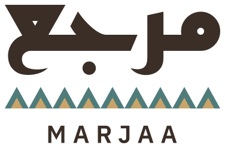

# Marjaa brand

The source of truth for how Marjaa (مرجع) looks, for this site and for any
future Marjaa product. The values here are the values in the code:

| What | Where |
|---|---|
| Colour tokens | [`web/src/app/tokens.css`](../web/src/app/tokens.css) |
| Type scale, motion | [`web/src/app/globals.css`](../web/src/app/globals.css) |
| Logo files | [`web/public/brand/`](../web/public/brand/), drawn by [`scripts/build_brand.py`](../scripts/build_brand.py) |
| Contrast checks | [`web/src/lib/contrast.test.ts`](../web/src/lib/contrast.test.ts) |

Marjaa means *reference*. The brand should feel like a well-made legal reference:
calm, exact, warm, and plainly from the Gulf. The Gulf identity comes from three things
only: the Arabic wordmark, the Sadu band, and the palette. No palm trees, skylines,
falcons, camels, gradients or "AI" sparkle.

## Logo



The logo has three parts, stacked and centred:

1. **The wordmark** مرجع in Reem Kufi, weight 700, in Date (`#3A2E26`).
2. **The Sadu band**, a row of triangles after Al Sadu, the Emirati Bedouin weave.
   It is exactly as wide as the wordmark, in nine tiles.
3. **MARJAA** in IBM Plex Sans 600, capitals, letter-spacing 0.26 em, in Date.

Construction, with *B* the height of the band:

- the band sits 0.55 *B* under the lowest point of the wordmark;
- MARJAA's capitals are 0.8 *B* tall and sit 0.8 *B* under the band.

All text in the logo files is converted to outlines, so they render the same
everywhere with no fonts installed. To change the logo, change
`scripts/build_brand.py` and run `uv run scripts/build_brand.py`: it rewrites every
file below and the copy the web app uses (`web/src/components/brand/glyphs.ts`).

### Variants

| File | Use |
|---|---|
| `logo-primary.svg` | The default, on Pearl or Sand. |
| `logo-reversed.svg` | On a Sea field: wordmark and MARJAA in Pearl, band in Sand and Pearl gold. Use it where the logo needs to stand on colour (a cover, a slide, a sign). |
| `logo-header.svg` | The compact horizontal lockup for headers: مرجع over a thin one-colour band (Sea, no gold), MARJAA beside it. |
| `icon.svg`, `icon-192.png`, `icon-512.png` | App icon: a Sea square with 22% corner radius, م in Pearl slightly above centre, a strip of the band (Sand and Pearl gold) along the bottom edge. |
| `apple-touch-icon.png` | The same, full square: iOS rounds the corners itself. |
| `favicon.svg`, `favicon-16.png`, `favicon-32.png`, `favicon.ico` | At 16 and 32 px the band is dropped and م is set larger, so it stays legible. |
| `og.png` (1200 × 630) | Link previews: Sand ground, primary logo, "Cited answers on UAE Labour Law", the band along the bottom edge. |

In the web app the logo is drawn from the same geometry but coloured by theme
tokens (`--brand-ink`, `--brand-sea`, `--brand-gold`), so in dark mode the
wordmark turns Pearl and the band a lighter Sea.

### Clear space and minimum size

- **Clear space:** keep free space of at least 2 *B* (twice the band height) on
  every side of the primary logo, and half the lockup's height around the header
  lockup. Nothing else, text included, enters it.
- **Minimum sizes:** primary logo 96 px wide on screen (25 mm in print); header
  lockup 24 px tall; app icon 16 px, where only the م version is used.

### Do

- Use the files as they are, on Pearl, Sand or Sea.
- Use the reversed logo on Sea, and the primary logo everywhere else.
- Scale the logo as a whole.

### Don't

- Recolour the logo outside the palette, or put it on a photograph or a busy pattern.
- Stretch, rotate, outline, shadow or add effects to any part of it.
- Rearrange the parts, change the band's tile count, or set the wordmark in another typeface.
- Separate MARJAA from the wordmark in the primary logo, or translate it.
- Use the full band inside the favicon at 16 or 32 px.

## Colour

### Brand colours

| Name | Hex | Token | Use |
|---|---|---|---|
| Pearl | `#FAF7F1` | `--pearl` | Main background (light) |
| Sand | `#F3EBDD` | `--sand` | Raised surfaces: panels, chips, the composer |
| Dune | `#E9DCC4` | `--dune` | Borders, dividers, subtle fills |
| Sea | `#4F7C7A` | `--sea` | Primary brand colour: fills, focus rings, the band, chart bars |
| Pearl gold | `#C9A46A` | `--pearl-gold` | Accent only: the band, small markers. Never text. |
| Date | `#3A2E26` | `--date` | Main text (light) |
| Date muted | `#6B5E52` | `--date-muted` | Secondary text |

### Derived scales

Sea is too light for small text: `#4F7C7A` on Pearl is 4.37:1, below the 4.5:1
that WCAG AA asks of body text. So the brand Sea is kept for fills and graphics,
and darker steps of the same hue carry text and buttons. The scale is derived in
OKLCH at the brand hue, with 500 as the brand Sea:

| Step | Hex | Used for |
|---|---|---|
| sea-50 | `#EEF3F1` | Verified citation chips, selected states (light) |
| sea-100 | `#E1EBE8` | |
| sea-200 | `#C6D8D4` | Chip borders (light); pressed buttons (dark) |
| sea-300 | `#A3C3BF` | Button hover (dark) |
| sea-400 | `#85AEAC` | Buttons, focus, chart bars (dark) |
| **sea-500** | **`#4F7C7A`** | **Brand Sea** |
| sea-600 | `#406C6B` | Primary buttons (light): Pearl text 5.49:1 |
| sea-700 | `#315E5C` | Links and accent text (light): 6.80:1 on Pearl; button hover |
| sea-800 | `#23504F` | Pressed buttons (light) |
| sea-900 | `#11403F` | |

Warm neutrals, derived at the hue of Date: `#8B7D71` for form-field borders
(3.7:1 on Pearl, so fields stay visible) and `#75685B` for captions and
placeholders (5.05:1, still AA).

### Semantic tokens

Components never use a hex value or a brand name directly. They use roles, and
dark mode redefines the roles, never the brand colours. Tailwind is configured
with these tokens only, so `bg-white` or `text-gray-500` do not exist in this
codebase.

| Role | Light | Dark |
|---|---|---|
| `--bg` | Pearl | `#1E150E` |
| `--surface` | Sand | `#281E17` |
| `--surface-strong` | Dune | `#322821` |
| `--line` | Dune | `#40362F` |
| `--line-strong` | `#8B7D71` | `#7C6F63` |
| `--ink` | Date | Sand |
| `--ink-muted` | Date muted | `#C2B5A9` |
| `--ink-faint` | `#75685B` | `#A2968A` |
| `--accent` (text) | sea-700 | `#99C0BE` |
| `--accent-fill` (buttons) | sea-600 | sea-400 |
| `--on-accent` | Pearl | `#1E150E` |
| `--brand-sea` | Sea | `#689694` |
| `--focus` | Sea | sea-400 |
| `--warn` / `--warn-subtle` | `#755829` / `#F6EAD6` | `#DDBF91` / `#33291B` |
| `--danger` / `--danger-subtle` | `#993B29` / `#F8E6DF` | `#E5A598` / `#3A231D` |

**Dark mode** is a warm, deep date-brown, never black and never a cold blue-grey;
text is set in Sand. It follows the system setting until the visitor picks a theme
with the toggle; the choice is remembered.

**Status colours** (warn, danger) are kept for states: an unverified citation, the
busy demo, an error. They always come with an icon and words, never colour alone,
and are never used as decoration.

### Contrast

Every pair below is checked by `web/src/lib/contrast.test.ts` in both themes; the
test fails if one drops below its minimum. This table is its output
(`REPORT=1 npx vitest run src/lib/contrast.test.ts --reporter=verbose`).
Text needs 4.5:1; borders, focus rings and graphics need 3:1.

| Use | Pair | Light | Dark | Needs |
|---|---|---|---|---|
| Body text | `--ink` on `--bg` | 12.28:1 | 15.18:1 | 4.5:1 |
| Body text | `--ink` on `--surface` | 11.10:1 | 13.77:1 | 4.5:1 |
| Body text | `--ink` on `--surface-strong` | 9.69:1 | 12.14:1 | 4.5:1 |
| Secondary text | `--ink-muted` on `--bg` | 5.87:1 | 8.96:1 | 4.5:1 |
| Secondary text | `--ink-muted` on `--surface` | 5.30:1 | 8.13:1 | 4.5:1 |
| Secondary text | `--ink-muted` on `--surface-strong` | 4.63:1 | 7.17:1 | 4.5:1 |
| Captions, placeholders | `--ink-faint` on `--bg` | 5.05:1 | 6.22:1 | 4.5:1 |
| Captions, placeholders | `--ink-faint` on `--surface` | 4.56:1 | 5.64:1 | 4.5:1 |
| Links, accent text | `--accent` on `--bg` | 6.80:1 | 9.10:1 | 4.5:1 |
| Links, accent text | `--accent` on `--surface` | 6.15:1 | 8.26:1 | 4.5:1 |
| Links, accent text | `--accent` on `--accent-subtle` | 6.49:1 | 6.99:1 | 4.5:1 |
| Button labels | `--on-accent` on `--accent-fill` | 5.49:1 | 7.40:1 | 4.5:1 |
| Button labels | `--on-accent` on `--accent-fill-hover` | 6.80:1 | 9.51:1 | 4.5:1 |
| Button labels | `--on-accent` on `--accent-fill-press` | 8.42:1 | 12.13:1 | 4.5:1 |
| Warnings | `--warn` on `--bg` | 6.17:1 | 10.21:1 | 4.5:1 |
| Warnings | `--warn` on `--warn-subtle` | 5.55:1 | 8.10:1 | 4.5:1 |
| Errors | `--danger` on `--bg` | 6.52:1 | 8.70:1 | 4.5:1 |
| Errors | `--danger` on `--danger-subtle` | 5.77:1 | 7.07:1 | 4.5:1 |
| Wordmark | `--brand-ink` on `--bg` | 12.28:1 | 16.80:1 | 4.5:1 |
| Wordmark | `--brand-ink` on `--surface` | 11.10:1 | 15.24:1 | 4.5:1 |
| Focus ring | `--focus` on `--bg` | 4.37:1 | 7.40:1 | 3:1 |
| Focus ring | `--focus` on `--surface` | 3.94:1 | 6.71:1 | 3:1 |
| Form field borders | `--line-strong` on `--bg` | 3.73:1 | 3.69:1 | 3:1 |
| Form field borders | `--line-strong` on `--surface` | 3.37:1 | 3.35:1 | 3:1 |
| Chart bars | `--chart` on `--bg` | 4.37:1 | 7.40:1 | 3:1 |
| Chart bars | `--chart` on `--surface` | 3.94:1 | 6.71:1 | 3:1 |
| Sadu band | `--brand-sea` on `--bg` | 4.37:1 | 5.46:1 | 3:1 |
| Sadu band | `--brand-sea` on `--surface` | 3.94:1 | 4.95:1 | 3:1 |

## Typography

| Family | Use |
|---|---|
| **IBM Plex Sans** | Latin interface and body text |
| **IBM Plex Sans Arabic** | Arabic interface and body text. Drawn as one family with Plex Sans, so the two scripts sit evenly side by side. |
| **Reem Kufi** 700 | The logo, and sparingly, large Arabic display headings (the Arabic page titles). Never body text. |
| **IBM Plex Mono** 500 | Latin citation references only: `Art. 29`. Arabic references (المادة 29) use Plex Sans Arabic. |

Fonts load with `next/font`: subset, self-hosted, no layout shift.

### Scale

| Role | Size | Line height (Latin / Arabic) |
|---|---|---|
| Display | 40 → 72 px (fluid) | 1.02 / 1.3 |
| H1 | 32 → 48 px | 1.1 / 1.35 |
| H2 | 24 → 32 px | 1.2 / 1.45 |
| H3 | 20 px | 1.35 / 1.6 |
| Lead | 19 px | 1.6 / 1.85 |
| Body | 17 px (Arabic reading text 18 px) | 1.7 / 1.95 |
| Small | 15 px | 1.55 / 1.8 |
| Caption | 13 px | 1.45 / 1.7 |

Arabic always gets more line height than Latin at the same size; the `:lang(ar)`
rules in `globals.css` apply it automatically. Headings are 600 (Reem Kufi 700 for
Arabic display); body text is 400; running text is set in full ink, and the muted
colour is for secondary notes only.

Numbers use Western digits in both languages, as UAE government sites do, with
tabular figures wherever numbers line up.

## Iconography

- One set: [Lucide](https://lucide.dev), stroke 1.75, at 14–20 px, in the colour of
  the text beside it.
- Use icons sparingly, next to a word, never as decoration and never on top of
  feature cards. Icon-only buttons carry an `aria-label`.
- Directional icons (arrows) mirror in Arabic; the external-link arrow does too.
- The one exception to the set is GitHub's own mark (Octicons), since Lucide has
  no brand icons.

## The Sadu band

The band is the one ornament. Each tile is 20 × 18 units:

```svg
<polygon points="0,18 10,0 20,18" />  <!-- large triangle: Sea -->
<polygon points="5,18 10,9 15,18" />  <!-- small triangle: Pearl gold -->
```

Tiles repeat edge to edge, horizontally, with their bases on a common line.

| Context | Colours |
|---|---|
| On Pearl or Sand | Sea + Pearl gold |
| On Sea | Sand + Pearl gold |
| Thin, single-colour (header lockup) | Sea only |
| Dark mode | `--brand-sea` (`#689694`) + Pearl gold |

Where it appears:

- in the logo and the app icon;
- once, full width, as the top edge of the footer;
- as the loading indicator, its tiles filling one after another;
- as the arrowheads of diagrams (one triangle, inverted or turned);
- on the not-found page.

Rules:

- Keep the proportions; scale whole tiles, never stretch them.
- Always horizontal, bases down. Never rotate it, curve it or run it vertically.
- At most one full band per screen. It is not a section divider.
- Never behind or under text, and never recoloured outside the table above.

### Motion

Motion is small and has a job. The band in the header draws in once on the first
load, tile by tile; the loader pulses while articles are found; answers stream in
with a caret in Sea; panels slide in by 12 px. Nothing moves on scroll. With
`prefers-reduced-motion`, all of it stops and the content shows at once.

## Layout and components

- **Grid:** a 1216 px container (76 rem) with 20 px margins on phones and 32 px
  from tablets up, on 12 columns. Reading text keeps to about 68 characters.
- **Corners:** 3 px for chips, 4 px for buttons and fields, 6 px for panels. The
  app icon's 22% radius belongs to the icon only.
- **Surfaces** are separated by a step in tone (Pearl → Sand → Dune) and Dune lines.
  Shadows are only for things that float over the page: the mobile menu and the
  article sheet.
- **Buttons:** one primary per view, filled with `--accent-fill`; secondary buttons
  are outlined with `--line-strong`. Labels say what happens ("Ask", "Open in the
  Library").
- **Focus:** a 2 px ring in Sea, offset 2 px, on everything that takes focus.
- **Citation chips** read like legal references: `Art. 29` in Plex Mono, or
  المادة 29 in Plex Sans Arabic, on Sea-50 with a check when verified; dashed, in
  the warn colours with a warning icon when the article was not retrieved.

## Bilingual rules

- Every label, button and page exists in English and Modern Standard Arabic. The
  Arabic is written for Arabic readers, not translated word for word.
- Arabic pages are `dir="rtl"`, under `/ar`. Layout uses logical properties
  (`margin-inline-start`, `ps-*`, `start-*`), so it mirrors by construction.
- Mixed text is isolated (`<bdi>`, `dir="auto"`), so numbers, ranges and Latin terms
  keep their order inside Arabic sentences.
- The Arabic text of the law is authoritative and is always marked so. Where both
  texts sit side by side, English is on the left and Arabic on the right, as in the
  bilingual official gazette.
